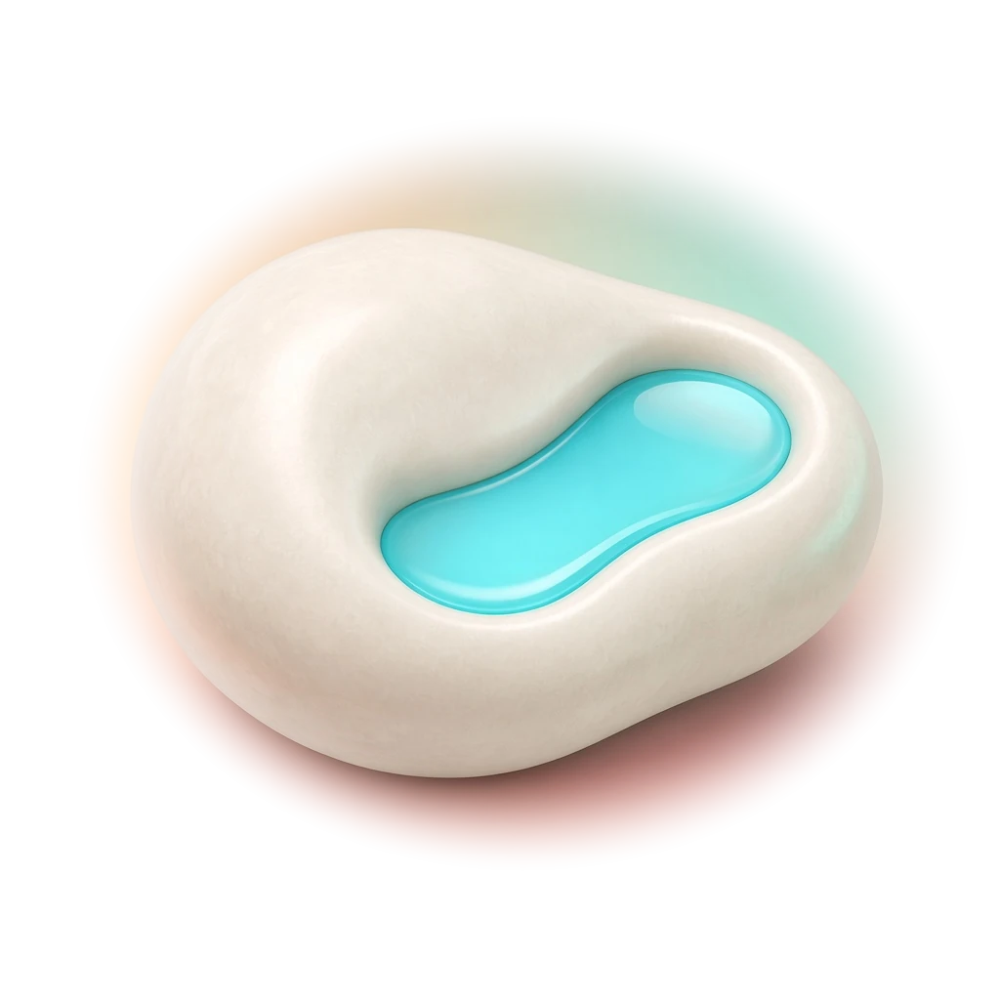

# Cove — Community Netlify Guide

> **Live Demo**: [`https://cove-netlify-bot.netlify.app`](https://cove-netlify-bot.netlify.app) · **Shareable Knowledge Guide**: [`/netlify-ai.md`](https://cove-netlify-bot.netlify.app/netlify-ai.md)
>
> *Fan-made community helper for the Netlify CLI, Functions, Netlify Server, and Previews. Not an official Netlify product and not affiliated with Netlify.*

<p align="center">
  
</p>

Cove is an open-source, grounded developer guide with an original mascot named **Buoy**. It answers questions about the Netlify CLI, Functions, Netlify Server, Blobs, Forms, redirects, and deploys using official documentation from [netlify.ai](https://netlify.ai) and [docs.netlify.com](https://docs.netlify.com), plus read-only CLI research checks (`netlify --version`, `netlify --help`, `netlify <command> --help`). Verified claims are compiled into [`knowledge/netlify-ai.md`](knowledge/netlify-ai.md) and served directly at `/netlify-ai.md`.

---

## Features

- **Grounded Netlify Knowledge Base**: Fetches `netlify.ai`, `docs.netlify.com/llms.txt`, and core platform docs, logging verified claims with sources and timestamps.
- **Netlify Server + Functions Gateway**: Runs on [Netlify Server](https://docs.netlify.com/build/server/) (`netlify/server/index.js`) with a buffered Netlify Function gateway (`netlify/functions/cove.js`) for clean HTTP/2 SSE and JSON responses across both production deploys and `netlify dev --live` tunnels.
- **BYOK & OpenRouter PKCE Sign-In**: Visitors can bring their own OpenRouter, OpenAI, Anthropic, Gemini, or xAI API key (kept strictly in browser tab `sessionStorage`) or sign in with OpenRouter OAuth PKCE — zero shared host API keys.
- **Read-Only Netlify Account Linking (3 Flows)**: Link a Netlify account via CLI login ticket, Netlify Web OAuth, or personal access token so Cove can answer site- and deploy-specific questions without write/deploy/DNS/billing permissions.
- **Local Conversation History**: Browser-local conversation threads with automatic tagging, search, and JSON export.
- **100% Free & Open Access**: Zero paywalls, zero gated tiers, MIT licensed.

---

## Quickstart (Local Development)

Requires **Node.js 24+** and **Netlify CLI 27.20.0+**.

```bash
git clone https://github.com/1nc0gn30/netlify-bot.git
cd netlify-bot
npm install
cp .env.example .env
npm run dev
```

Open `http://localhost:8971`.

To opt in to local host CLI agents (`agy`, Hermes, etc.) **on localhost only**:

```bash
COVE_LOCAL_AGENTS=1 npm run dev
```

---

## Deploying to Netlify

1. Link or create a Netlify site:
   ```bash
   netlify init   # or: netlify link
   ```
2. Configure production environment variables (optional, for Netlify Web OAuth & CLI ticket auth):
   ```bash
   netlify env:set NETLIFY_OAUTH_CLIENT_ID "<your-client-id>" --secret --context production
   netlify env:set NETLIFY_OAUTH_CLIENT_SECRET "<your-client-secret>" --secret --context production
   netlify env:set NETLIFY_OAUTH_REDIRECT_URI "https://<your-site>.netlify.app/api/netlify/oauth/callback" --context production
   netlify env:set COVE_PUBLIC_ORIGIN "https://<your-site>.netlify.app" --context production
   ```
3. Register the exact Redirect URI (`https://<your-site>.netlify.app/api/netlify/oauth/callback`) in [app.netlify.com → User settings → Applications](https://app.netlify.com/user/applications).
4. Deploy:
   ```bash
   netlify deploy --prod
   ```

---

## Linking a Netlify Account (Read-Only)

Cove supports three read-only account linking flows in the **Account** drawer:

1. **Netlify CLI Ticket**: Same flow as `netlify login --request`. Cove creates a login ticket, you approve the URL on `app.netlify.com`, and Cove links the session without touching your host CLI keychain.
2. **Netlify Web OAuth**: Standard OAuth 2.0 Authorization Code flow using HMAC-SHA256 signed `state` (`v1.<payload>.<sig>`) and an AES-256-GCM encrypted `HttpOnly; Secure; SameSite=Lax` cookie (`cove_nf_link`) so linked sessions persist across stateless Netlify Function instances without exposing tokens to browser JavaScript.
3. **Personal Access Token**: Pasted into the Account drawer, verified against `api.netlify.com/api/v1/user`, and sealed into the encrypted `HttpOnly` session cookie (plus local `0600` store in `logs/cove-account-sessions.json` during local dev).

---

## Security & Trust Model

- **Fail-closed local agents**: Local host agents are disabled by default (`COVE_LOCAL_AGENTS=0`). Even when enabled locally, any request arriving via `*.netlify.live`, `*.netlify.app`, non-localhost `Host`/`Origin`/`Referer`, or forwarding headers (`x-forwarded-*`, `x-nf-*`) is strictly refused (`403`).
- **No shell execution**: All read-only CLI checks run via `execFile` against a strict command allowlist with timeouts — user input is never interpolated into a shell.
- **Zero token leakage**: Visitor API keys stay in tab `sessionStorage`; Netlify OAuth tokens stay in `HttpOnly` encrypted cookies or gitignored `0600` local files and are never logged or written to `/netlify-ai.md`.
- **Rate limits & input caps**: Per-session request throttling and prompt length limits enforced server-side.

---

## Testing & Verification

```bash
# Full unit & local-access security suite
npm test

# Syntax, secret-leak & production guardrail suite (Schema.org, robots.txt, sitemap, tags)
node --test tests/test_app.mjs

# Full git-history secret scan
npm run gitleaks
```

---

## Attribution & Support

Engineered by **Neal Frazier Tech** ([@1nc0gn30](https://github.com/1nc0gn30)) • [NullAI Platform](https://nullai.tech)  
Licensed under the [MIT License](LICENSE).

Cove is 100% free and open access with zero paywalls. If it helps you ship faster:
- ☕ [Buy Us a Coffee (Stripe)](https://buy.stripe.com/3cIfZg27PdKo2D64Ocfw40X)
- ◎ Solana Tip: `GG2eQbVh8ut1BK6j1A2tz7pSySdLpD38BgyEhGcxdXoK`
